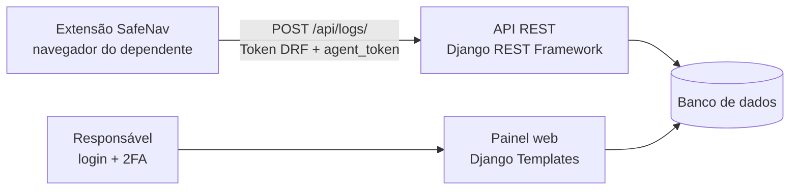

# 🛡️ SafeNav

> Plataforma de **cuidado parental digital**: um painel web para responsáveis acompanharem a navegação de seus dependentes, com categorização automática de sites, palavras de alerta personalizadas e autenticação em duas etapas (2FA).

Projeto de conclusão de pós-graduação.

🌐 **Aplicação em produção:** https://safenav.duckdns.org/

---

## 📌 Sumário

1. [Visão geral](#-visão-geral)
2. [Arquitetura](#-arquitetura)
3. [Segurança — 3 itens do OWASP Top 10 mitigados (Eixo 3)](#-segurança--3-itens-do-owasp-top-10-mitigados-eixo-3)
4. [Estrutura do repositório](#-estrutura-do-repositório)
5. [Como executar](#-como-executar)
6. [Extensão do navegador](#-extensão-do-navegador)
7. [API](#-api)
8. [Tecnologias](#-tecnologias)
9. [Limitações conhecidas e melhorias futuras](#-limitações-conhecidas-e-melhorias-futuras)
10. [Licença](#-licença)

---

## 🎯 Visão geral

O SafeNav é composto por duas partes:

- **Backend / Painel web (Django + Django REST Framework):** o responsável cria sua conta, ativa o 2FA, cadastra os dependentes e acompanha o histórico de navegação deles.
- **Extensão de navegador (Chrome, Manifest V3):** instalada no navegador do dependente, envia à API a URL e o título de cada página visitada.

**Funcionalidades**

- Cadastro e login de responsáveis, com **2FA (TOTP)** via Google Authenticator / Authy.
- Cadastro e exclusão de dependentes; cada um recebe um **token de agente** único e aleatório.
- **Categorização automática** dos acessos: `Estudo`, `Entretenimento`, `Alto Risco` ou `Geral`.
- **Palavras de alerta personalizadas:** qualquer URL ou título que contenha um termo cadastrado pelo responsável é marcado como `Alto Risco`.
- Dashboard com os 50 acessos mais recentes de todos os dependentes da conta.

---

## 🧱 Arquitetura



---

## 🔐 Segurança — 3 itens do OWASP Top 10 mitigados (Eixo 3)

Os três itens abaixo seguem o **OWASP Top 10 (edição 2021)**. Para cada um estão indicados o risco, a mitigação aplicada e **onde encontrá-la no código**.

### 1) A01:2021 — Broken Access Control (Controle de Acesso Quebrado)

**Risco:** um usuário acessar, alterar ou apagar dados de outra família (por exemplo, trocando o `id` na URL — ataque conhecido como IDOR).

**Mitigação aplicada**

- Todas as telas internas exigem autenticação com `@login_required`.
- Toda consulta é **filtrada pelo dono do dado** (`parent=request.user`). Um responsável nunca enxerga dependentes, logs ou palavras de alerta de outra conta.
- A exclusão de dependente usa `get_object_or_404(ChildProfile, id=id, parent=request.user)`: se o `id` pertencer a outro responsável, a resposta é `404`, e a exclusão só ocorre via `POST` (com token CSRF).
- A API de coleta exige autenticação (`TokenAuthentication` + `IsAuthenticated`).

**Onde está no código**

| O que | Arquivo | Local |
|---|---|---|
| Rotas protegidas por login | `core/views.py` | `dashboard_view`, `register_dependent`, `delete_dependent`, `setup_2fa_view` (`@login_required`) |
| Isolamento de dados por conta | `core/views.py` | `dashboard_view` — `ChildProfile.objects.filter(parent=request.user)` e `AlertWord.objects.filter(parent=request.user)` |
| Proteção contra IDOR | `core/views.py` | `delete_dependent` — `get_object_or_404(..., parent=request.user)` |
| Vínculo do dependente ao responsável | `core/views.py` / `core/models.py` | `register_dependent` (`dependent.parent = request.user`) / `ChildProfile.parent` (`ForeignKey`) |
| API autenticada | `core/views.py` | `LogAPIView` — `authentication_classes` e `permission_classes` |
| Proteção CSRF ativa em todo o projeto | `safenav_project/settings.py` | `MIDDLEWARE` — `CsrfViewMiddleware` (+ `AuthenticationMiddleware` e `SessionMiddleware`) |
| Token CSRF nos formulários | `login.html`, `dashboard.html`, `register_dependent.html`, `registro.html` | `` |

---

### 2) A07:2021 — Identification and Authentication Failures (Falhas de Identificação e Autenticação)

**Risco:** roubo de credenciais, senhas fracas, falta de segundo fator, tokens previsíveis.

**Mitigação aplicada**

- **Autenticação em duas etapas (2FA/TOTP)** com `django-otp`: o responsável escaneia um QR Code no app autenticador e, depois de ativado, passa a informar o código de 6 dígitos a cada login.
- Senhas armazenadas com o **hash do Django** (nunca em texto puro) e cadastro feito pelo `UserCreationForm`, que aplica os validadores de senha do Django.
- Mensagens de erro de login **genéricas** (não revelam se o usuário existe).
- O `agent_token` de cada dependente é gerado com `secrets.token_hex(32)` (256 bits, gerador criptograficamente seguro) e é `unique` no banco.
- A API exige **dois fatores de identificação**: o Token DRF (autenticação) e o `agent_token` (identifica o dependente).
- O token do agente fica **mascarado** no dashboard (`input type="password"`, com botão de mostrar/ocultar).

**Onde está no código**

| O que | Arquivo | Local |
|---|---|---|
| Verificação do código 2FA no login | `core/views.py` | `login_view` — `authenticate()` + `match_token()` |
| Geração do QR Code / ativação do 2FA | `core/views.py` | `setup_2fa_view` — `TOTPDevice` + `qrcode` |
| 2FA habilitado no projeto | `safenav_project/settings.py` | `INSTALLED_APPS` (`django_otp`, `django_otp.plugins.otp_totp`) e `MIDDLEWARE` (`OTPMiddleware`) |
| Política de senhas | `safenav_project/settings.py` | `AUTH_PASSWORD_VALIDATORS` (similaridade com o usuário, tamanho mínimo, senhas comuns, senhas só numéricas) |
| Tokens de API | `safenav_project/settings.py` | `INSTALLED_APPS` — `rest_framework.authtoken` |
| Tela de configuração do 2FA | `setup_2fa.html` | QR Code em Base64 |
| Campo do código de 6 dígitos | `login.html` | `input name="token_2fa"` |
| Cadastro com validação de senha | `core/views.py` | `register_user` — `UserCreationForm` |
| Token aleatório e seguro do dependente | `core/views.py` / `core/models.py` | `register_dependent` — `secrets.token_hex(32)` / `ChildProfile.agent_token` (`unique=True`) |
| Autenticação da API | `core/views.py` | `LogAPIView` — `TokenAuthentication` |
| Token mascarado na interface | `dashboard.html` | `input type="password"` + `toggleToken()` |

---

### 3) A03:2021 — Injection (Injeção, incluindo XSS)

**Risco:** dados enviados pelo usuário (formulários, API) serem interpretados como código — SQL Injection ou Cross-Site Scripting (XSS).

**Mitigação aplicada**

- **Django ORM em todo o acesso a dados:** não há SQL montado por concatenação de strings; as consultas são parametrizadas.
- **Auto-escape dos templates do Django:** URLs, títulos de páginas e palavras de alerta (dados vindos de terceiros) são exibidos com `{{ ... }}`, que escapa HTML e impede a execução de scripts injetados.
- **Validação de entrada** por `ModelForm`/`Serializer`: a API só aceita os campos `url`, `title`, `timestamp` e `category` e valida o tipo de cada um (`URLField`, `max_length`).
- **Normalização** das palavras de alerta (`strip().lower()`) antes de gravar.
- A categoria **não é aceita do cliente**: é sempre sobrescrita pelo servidor (`dados['category'] = categoria_definida`).

**Onde está no código**

| O que | Arquivo | Local |
|---|---|---|
| Consultas via ORM (sem SQL cru) | `core/views.py` | `LogAPIView.post`, `dashboard_view` |
| Validação dos dados recebidos pela API | `core/serializers.py` | `NavigationLogSerializer` (`fields` explícitos) |
| Tipos e limites dos campos | `core/models.py` | `URLField(max_length=2000)`, `CharField(max_length=...)` |
| Validação do formulário de dependente | `core/forms.py` | `DependentForm` (`fields = ['name']`) |
| Escape automático ativo | `safenav_project/settings.py` | `TEMPLATES` — backend `DjangoTemplates` (autoescape habilitado por padrão) |
| Escape automático na saída | `dashboard.html` | `{{ log.title }}`, `{{ log.url }}`, `{{ item.word }}` |
| Categoria definida pelo servidor | `core/views.py` | `LogAPIView.post` — bloco "Lógica de Categorização Dinâmica" |
| Normalização de entrada | `core/views.py` | `dashboard_view` — `palavra.strip().lower()` |

---

### 🧩 Medidas complementares

- **Proteção contra clickjacking e cabeçalhos de segurança:** `SecurityMiddleware` e `XFrameOptionsMiddleware` ativos em `settings.py`.
- **Credenciais fora do código:** o workflow `.github/workflows/deploy.yml` lê host, usuário, chave SSH e a chave secreta do Django de **GitHub Secrets** (`AWS_HOST`, `AWS_USER`, `AWS_SSH_KEY`, `DJANGO_SECRET_KEY`).
- **Configuração de produção (A05 – Security Misconfiguration)**, em `safenav_project/settings.py`:
  - `DEBUG = False`: o servidor não exibe páginas de erro com código-fonte, variáveis e rotas;
  - `SECRET_KEY` fora do código: lida da variável de ambiente `SECRET_KEY`, que o deploy injeta a partir de um **GitHub Secret** (`DJANGO_SECRET_KEY`); a chave anterior, que havia sido versionada, foi substituída;
  - `ALLOWED_HOSTS` restrito ao domínio, ao IP e ao DNS da instância AWS, e `CSRF_TRUSTED_ORIGINS` limitado ao endereço HTTPS da aplicação.
- **Arquivos sensíveis ignorados:** o `.gitignore` bloqueia `.env`, `*.env`, `.env.*`, ambientes virtuais (`venv/`, `env/`), logs e `db.sqlite3`.

---

## 🗂️ Estrutura do repositório

```
SafeNav/
├── .github/workflows/     # deploy.yml — deploy automático na AWS (GitHub Actions)
├── core/                  # App principal
│   ├── models.py          # ChildProfile, NavigationLog, AlertWord
│   ├── views.py           # Login, 2FA, dashboard, dependentes e API de logs
│   ├── serializers.py     # NavigationLogSerializer
│   ├── forms.py           # DependentForm
│   ├── urls.py            # Rotas do app
│   ├── admin.py           # Registro dos modelos no Django Admin
│   └── templates/         # login, registro, dashboard, setup_2fa, register_dependent
├── extension/             # Extensão do Chrome (manifest.json + background.js)
├── safenav_project/       # Configurações do projeto Django (settings, urls, wsgi)
├── manage.py
├── .gitignore
└── LICENSE
```

**Modelo de dados**

| Modelo | Campos principais |
|---|---|
| `ChildProfile` | `parent` (FK → User), `name`, `agent_token` (único) |
| `NavigationLog` | `child` (FK → ChildProfile), `url`, `title`, `category`, `timestamp` |
| `AlertWord` | `parent` (FK → User), `word` |

---

## 🚀 Como executar

**Pré-requisitos:** Python 3.12+ (o projeto foi gerado com Django 6.x) e `pip`.

```bash
# 1. Clonar o repositório
git clone https://github.com/vasconcelosj46/SafeNav.git
cd SafeNav

# 2. Criar e ativar o ambiente virtual
python -m venv venv
source venv/bin/activate        # Windows: venv\Scripts\activate

# 3. Instalar as dependências
pip install django djangorestframework django-otp qrcode pillow

# 4. Definir a chave secreta do Django (variável de ambiente)
python -c "import secrets; print(secrets.token_urlsafe(64))"   # gera uma chave
export SECRET_KEY="cole-aqui-a-chave-gerada"                   # Windows (PowerShell): $env:SECRET_KEY="..."

# 5. Criar o banco de dados
python manage.py migrate

# 6. Criar um usuário administrador (opcional)
python manage.py createsuperuser

# 7. Subir o servidor
python manage.py runserver
```

> A chave secreta **não fica no código**: cada ambiente (sua máquina, servidor) define a sua em `SECRET_KEY`. O projeto vem com `DEBUG = False`; para acessar localmente use `http://127.0.0.1:8000/` ou `http://localhost:8000/`, hosts já liberados em `ALLOWED_HOSTS`. Para desenvolver com a página de erros detalhada, altere `DEBUG = True` em `safenav_project/settings.py` **apenas na sua máquina**, sem commitar.

Acesse **http://127.0.0.1:8000/**.

**Primeiros passos no painel**

1. Clique em **Cadastre-se** e crie a conta do responsável.
2. Faça login e clique em **⚙️ Configurar 2FA**; escaneie o QR Code no Google Authenticator ou Authy.
3. Clique em **+ Novo Dependente** e copie o **Token do Agente** (botão 👁️ no cartão).
4. Cadastre as **Palavras de Alerta** que quiser monitorar.
5. Gere o **Token da API** do responsável (usado pela extensão):
   ```bash
   python manage.py drf_create_token <nome_do_usuario>
   ```

---

## ☁️ Deploy

O deploy é automatizado por **GitHub Actions** (`.github/workflows/deploy.yml`). A cada `push` na branch `main`, o workflow:

1. conecta por SSH ao servidor na AWS (credenciais em *GitHub Secrets*);
2. atualiza o código em `/home/ubuntu/safenav` (`git fetch` + `git reset --hard origin/main`);
3. reinicia o **Nginx**;
4. libera a porta 8000, encerrando o Gunicorn anterior;
5. injeta a `SECRET_KEY` a partir do GitHub Secret `DJANGO_SECRET_KEY`;
6. sobe o novo **Gunicorn** (`safenav_project.wsgi:application`, em `127.0.0.1:8000`), com o Nginx atuando como proxy reverso;
7. faz uma checagem de saúde (`curl` em `127.0.0.1:8000`) e falha o deploy se a aplicação não responder.

A aplicação é servida em **HTTPS** em https://safenav.duckdns.org/.

---

## 🧩 Extensão do navegador

1. No Chrome, abra `chrome://extensions` e ative o **Modo do desenvolvedor**.
2. Clique em **Carregar sem compactação** e selecione a pasta `extension/`.
3. Edite `extension/background.js` e preencha:
   - `DRF_TOKEN`: token de autenticação da API do usuário responsável (gerado com `python manage.py drf_create_token <usuario>`);
   - `AGENT_TOKEN`: token do dependente, copiado do dashboard;
   - `API_URL`: endereço do backend (local: `http://127.0.0.1:8000/api/logs/`; produção: `https://safenav.duckdns.org/api/logs/`).
4. A cada página carregada, a extensão envia a URL e o título para o SafeNav.

> ⚠️ Nunca faça commit de tokens reais em `background.js`.

---

## 🔌 API

### `POST /api/logs/`

Registra um acesso de navegação.

**Headers**

```
Authorization: Token <DRF_TOKEN>
Content-Type: application/json
```

**Body**

```json
{
  "agent_token": "<token do dependente>",
  "url": "https://pt.wikipedia.org/",
  "title": "Wikipédia"
}
```

**Respostas**

| Código | Significado |
|---|---|
| `201` | Log salvo (retorna `url`, `title`, `timestamp`, `category`) |
| `400` | Dados inválidos |
| `401` | Token DRF ausente/inválido ou `agent_token` inexistente |

---

## 🛠️ Tecnologias

- **Backend:** Python, Django, Django REST Framework
- **Segurança:** `django-otp` (TOTP/2FA), `qrcode`, `secrets`
- **Frontend:** Django Templates + Tailwind CSS (CDN)
- **Extensão:** JavaScript, Chrome Extensions Manifest V3
- **Banco de dados:** SQLite (desenvolvimento)
- **CI/CD:** GitHub Actions (deploy via SSH)
- **Nuvem / servidor:** AWS, Nginx e Gunicorn

---

## 🔭 Limitações conhecidas e melhorias futuras

- O 2FA é **opcional até ser configurado**: contas sem dispositivo TOTP ainda entram só com usuário e senha.
- Adicionar **limite de tentativas de login** (rate limiting) para dificultar força bruta.
- A chave anterior do Django permanece no **histórico do Git** (foi substituída e não é mais usada); não reutilize essa chave em outros ambientes.
- Trocar SQLite por PostgreSQL em produção.
- Forçar **HTTPS** (redirecionamento HTTP → HTTPS no Nginx) e marcar os cookies de sessão e CSRF como *secure* (`SESSION_COOKIE_SECURE` e `CSRF_COOKIE_SECURE`).
- No workflow de deploy, fixar a versão da action `appleboy/ssh-action` (hoje usa `@master`) e incluir `pip install` e `migrate` no script.
- Cobertura de **testes automatizados** (`core/tests.py` ainda está vazio).
- Adicionar um `requirements.txt` para fixar as versões das dependências.

---

## 📄 Licença

Distribuído sob a licença **MIT**. Veja o arquivo [LICENSE](LICENSE).

---

**Autor:** [vasconcelosj46](https://github.com/vasconcelosj46)
